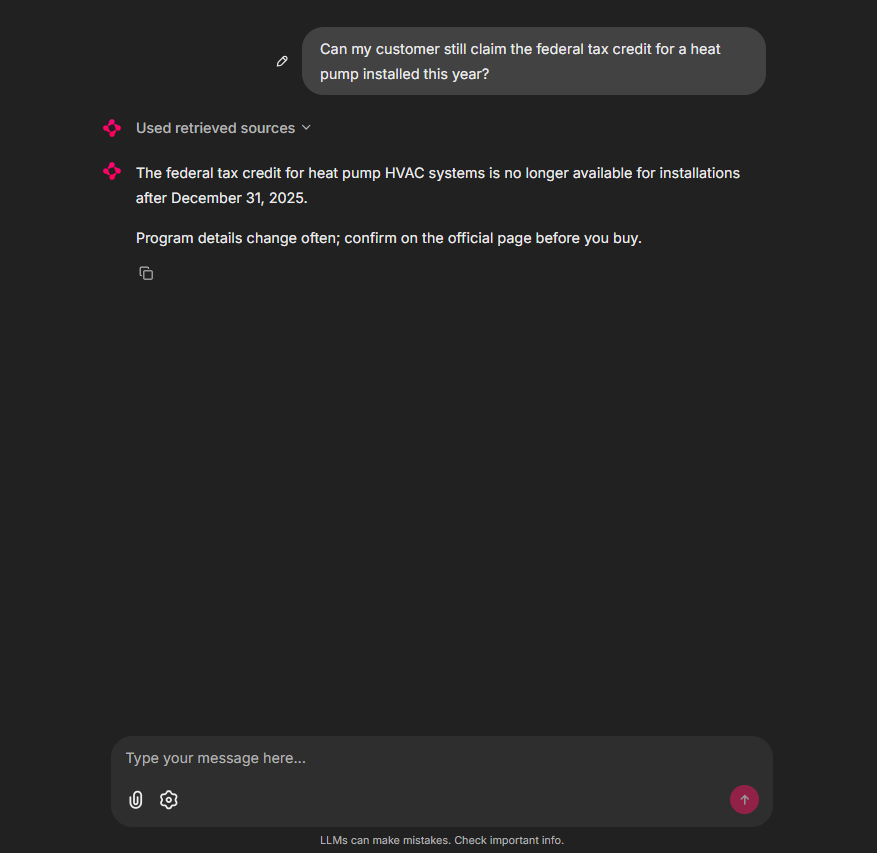
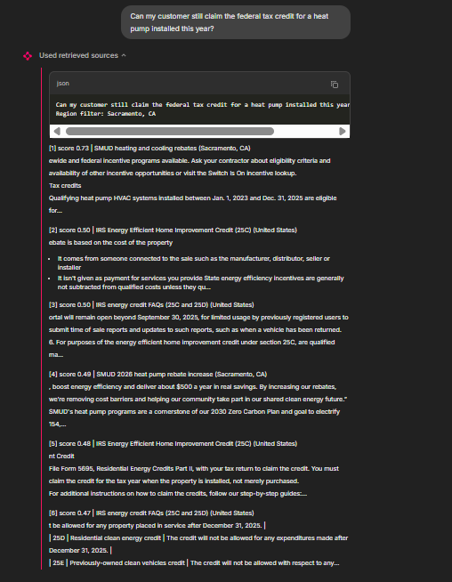
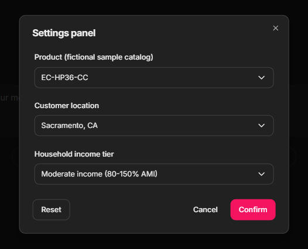

# IncentiveIQ: Cited Answers on Home-Energy Incentives

> A **retrieval-augmented generation (RAG)** assistant for heat pump, water heater and battery incentives. It answers only from official program pages, cites a source and fetch-date for every claim and filters programs by location.

[](https://www.trychroma.com/)
[-5a4fcf?style=flat-square)](https://ollama.com/library/qwen2.5)
[](https://trafilatura.readthedocs.io/)
[](https://chainlit.io/)
[](#tests)
[](https://www.python.org/)
[](LICENSE)



---

## Overview

Federal heat pump and battery tax credits **ended on December 31, 2025**. What remains is a patchwork: income-qualified state rebates that can run out of funding or go to a waitlist, and utility rebates with their own equipment and paperwork rules. Meanwhile, an LLM's training data still says *"claim up to $2,000 from the IRS"*, which is now wrong.

Dealers and buyers need answers grounded in **current official pages, with dates**. IncentiveIQ:

| Step | How |
| :--- | :--- |
| Collects official program pages | fetch → extract main text → chunk → embed into Chroma |
| Finds what applies to *this* customer | semantic search filtered to their city, state and nationwide programs |
| Decides whether it can answer at all | drops weak matches; if nothing relevant remains, says so **without calling the LLM** |
| Answers | LLM writes from numbered, dated sources only, with today's date in the prompt |
| Proves it | every `[n]` citation maps back to a URL and fetch-date in the UI |

---

## Key Features

- **Grounded answers with citations:** every amount and requirement is followed by `[n]`, linked to the official page and the date it was fetched
- **Location-scoped retrieval:** a Sacramento customer only sees Sacramento, California and nationwide programs, never another state's
- **Date-aware:** current date is in every prompt and programs whose end date has passed are reported as ended
- **Refuses when unsure:** a similarity threshold blocks low-relevance context, so off-topic questions get "not found" with no LLM call
- **Equipment check:** specs from a sample product catalog (compressor type, cold-climate rating, SEER2/HSPF2, certificate, connected controls) are compared against program requirements and the model must say when a requirement isn't stated
- **Retrieval transparency:** the UI shows the passages the model read and their similarity scores
- **Dealer settings:** product, customer location and income tier selectors via Chainlit chat settings
- **Robust ingestion:** pages that block scraping or need JavaScript are skipped with a reason instead of crashing the run; manual saves in `data/raw/` are used as a fallback

---

## System Architecture

```
OFFLINE  (python ingest.py)
sources.csv ─► fetch page ─► trafilatura: main text only ─► chunk (1,200 chars, 200 overlap)
                                                              │
                                                              ▼
                                          Chroma (cosine HNSW): embeddings + metadata
                                          {source_id, program, region, url, fetched_at}

AT QUESTION TIME  (Chainlit)
question + product + location + income tier
      │
      ▼
retriever.py ─ region filter: "Sacramento, CA" → [Sacramento, CA · California · United States]
             ─ top-6 chunks by cosine similarity
      │
      ▼   drop matches with similarity < 0.35 ──► none left? reply "not found" (no LLM call)
rag.py ─ prompt = today's date + household context + equipment specs + numbered, dated sources
      │
      ▼
LLM (Qwen 2.5 7B via Ollama, or GitHub Models), temperature 0.1
      │
      ▼
cited_sources(): parse [1], [1][3], [1, 3] ─► map to URLs ─► answer + Sources + retrieval trace
```



---

## Methodology

### 1. Ingestion

| Stage | Detail |
| :--- | :--- |
| **Sources** | `data/sources.csv`: 8 official pages covering a Sacramento utility, California, Massachusetts and Minnesota state programs, U.S. DOE and the IRS |
| **Extraction** | `trafilatura` keeps the main content (with tables) and drops menus, footers and scripts |
| **Chunking** | split on paragraph boundaries into ≤ 1,200-character chunks with a 200-character overlap, so a fact that straddles a boundary appears whole in at least one chunk |
| **Metadata** | every chunk carries `source_id`, `program`, `region`, `program_type`, `url`, `fetched_at` for filtering and citations |

### 2. Retrieval

- **Region expansion:** a city query also searches its state and nationwide programs
- **Similarity:** Chroma cosine distance converted to similarity (`1 − distance`), top 6 chunks
- **Relevance gate:** chunks below **0.35** similarity are discarded before generation

### 3. Generation Rules (system prompt)

| Rule | Why |
| :--- | :--- |
| Answer only from the numbered sources | no outside knowledge about programs, amounts or dates |
| Cite each source in its own brackets, `[1][3]` | keeps citations machine-parseable |
| Compare every date range with today's date | the model has no clock; ended programs must not be listed as available |
| Never claim equipment qualifies without a stated requirement | prevents invented eligibility |
| Say plainly when a program is closed, waitlisted or subject to funding | the most common way incentive answers go stale |
| End with an uncited "confirm on the official page" line | not financial or tax advice |

### 4. Citation Mapping

`cited_sources()` accepts `[1]`, `[1][3]` and `[1, 3]`, ignores numbers that don't match a retrieved chunk and deduplicates by URL, so the Sources list only shows pages the answer actually used.

---

## Results

| Question | Behaviour |
| :--- | :--- |
| *"Can my customer still claim the federal tax credit for a heat pump installed this year?"* | States that the credit ended on Dec 31, 2025, citing the IRS page with its fetch date |
| *"Which incentives can my selected product get here?"* (Sacramento) | Lists utility and state programs with cited amounts and requirements; can also list the ended 25C credit (see Limits) |
| *"Are income-qualified state rebates open right now?"* | Answers from the state program pages, noting waitlists or funding limits where the page states them |
| An off-topic question | "I couldn't find that in the program pages I have indexed", with no LLM call |




---

## Data


| File | Contents |
| :--- | :--- |
| `data/sources.csv` | Official program pages: id, program, region, program type, URL |
| `data/catalog.csv` | **Fictional sample equipment** from "An Electrification Company": three cold-climate heat pumps, a two-stage heat pump, a heat pump water heater and a 5 kWh battery, with the specs programs check |

---

## Repository Structure

```
incentive-iq/
│
├── ingest.py              # Fetch, extract, chunk and index program pages into Chroma
├── retriever.py           # Region-scoped semantic search
├── rag.py                 # Prompt assembly, grounded generation, citation mapping
├── app.py                 # Chainlit UI: settings, starters, sources, retrieval trace
├── chainlit.md
├── requirements.txt
├── .env.example           # Ollama or GitHub Models settings
│
├── data/
│   ├── sources.csv        # Official program pages to index
│   ├── catalog.csv        # Fictional sample equipment specs
│   └── raw/               # Optional manual page saves (fallback for blocked sites)
│
├── tests/
│   ├── conftest.py        # In-memory Chroma + offline hash embedding fixture
│   ├── test_ingest.py
│   ├── test_retriever.py
│   └── test_rag.py
│
└── docs/                  # Screenshots
```

---

## Setup & Usage

### 1. Clone and install

```bash
git clone https://github.com/AI-Energy-Projects/incentive-iq.git
cd incentive-iq
python -m venv .venv
source .venv/bin/activate       
pip install -r requirements.txt
```

### 2. Choose a model

```bash
cp .env.example .env
```

| Option | Setup |
| :--- | :--- |
| **Ollama (local, default)** | install [Ollama](https://ollama.com), then `ollama pull qwen2.5:7b` |
| **GitHub Models (hosted)** | set `LLM_BASE_URL=https://models.github.ai/inference`, `LLM_MODEL=openai/gpt-4.1-mini` and a GitHub token as `LLM_API_KEY` |

### 3. Build the index and run

```bash
python ingest.py                 
chainlit run app.py -w           
```

Pick a product, location and income tier in the settings panel, then try a starter question.

---

## Tests

```bash
python -m pytest -v               
```

Tests never download a model or touch the network: a **hash-based test embedding** replaces the real one, an **in-memory Chroma** collection replaces the database and a **fake LLM client** records the prompt it receives.

| Area | What is checked |
| :--- | :--- |
| **Ingestion** | chunk size limits, overlap on long paragraphs, empty text, a blocked page is skipped rather than fatal |
| **Retrieval** | city → state → nation expansion; the region filter never returns another state's programs; every hit carries citation metadata |
| **Generation** | citation parsing (`[1]`, `[1][3]`, `[1, 3]`, invalid numbers dropped); catalog specs and today's date are in the prompt; irrelevant questions are refused without an LLM call |

---

## Dependencies

```
chainlit
chromadb
trafilatura
requests
openai
python-dotenv
pytest
```

---

## Limits

- **An ended program can still appear as available** when the retrieved chunk omits its end date.
- **Partial citations:** Qwen 2.5 7B cites amounts reliably but sometimes leaves eligibility or paperwork bullets uncited.
- **Snapshot data:** answers are only as current as the last `python ingest.py`; the fetch date is shown so users can judge freshness.
- **Coverage:** 8 sources across three states is a prototype; real use needs many more programs.
- **Not financial or tax advice.** Confirm details on the official program page.

---

## Next Steps

- **Curated program-status layer:** a small verified table (ended, waitlisted) attached to every chunk from that program, overriding page text
- Flag uncited sentences automatically and ask the model to retry
- Scheduled re-ingestion with change detection
- Hybrid keyword + vector search for program names and codes

---

## Author

Built by **Shriya Padhi** as part of [AI Energy Projects](https://github.com/AI-Energy-Projects), a portfolio of applied AI prototypes for home electrification, energy storage, grid resilience and severe weather.

---

## References

- Lewis et al. [Retrieval-Augmented Generation for Knowledge-Intensive NLP Tasks](https://arxiv.org/abs/2005.11401) (NeurIPS 2020)
- Malkov & Yashunin [Efficient and Robust Approximate Nearest Neighbor Search Using HNSW Graphs](https://arxiv.org/abs/1603.09320) (2016), the index behind Chroma
- Barbaresi [Trafilatura: A Web Scraping Library and Command-Line Tool for Text Discovery and Extraction](https://aclanthology.org/2021.acl-demo.15/) (ACL 2021)
- IRS [Energy Efficient Home Improvement Credit](https://www.irs.gov/credits-deductions/energy-efficient-home-improvement-credit)
- U.S. DOE [Home Energy Rebates](https://www.energy.gov/save/home-energy-rebates)
- [Chroma](https://docs.trychroma.com) · [Chainlit](https://docs.chainlit.io) · [Ollama](https://ollama.com)
